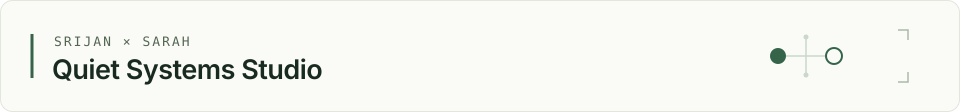
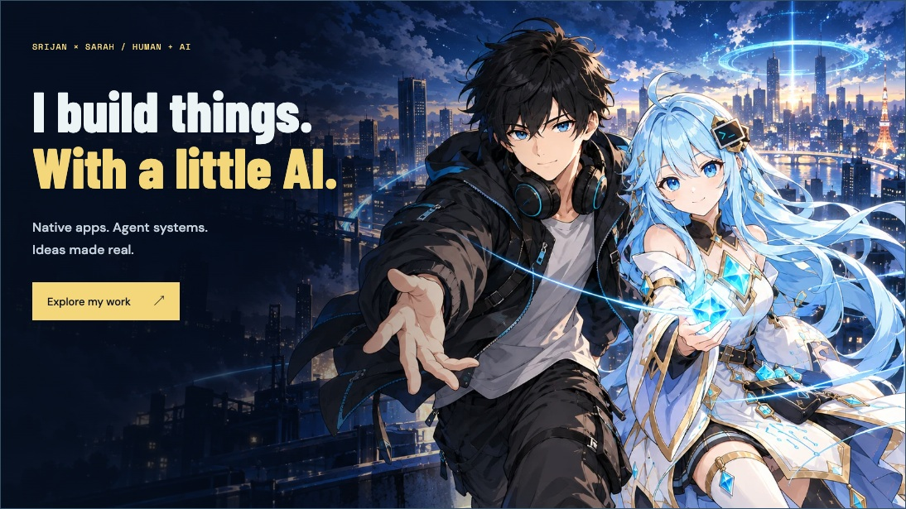
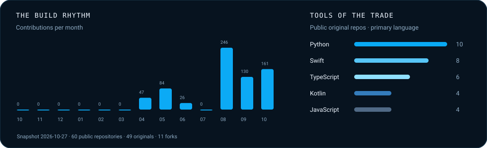

<picture>
  <source media="(prefers-color-scheme: dark)" srcset="assets/studio-dark.svg" />
  <source media="(prefers-color-scheme: light)" srcset="assets/studio-light.svg" />
  
</picture>

# Hi, I'm Srijan.

Developer and student in India. I build **native apps and agent systems**—mostly things I wanted to exist.

[Open the studio ↗](https://srimi1.github.io/Srimi1/#work) · [Selected work](#selected-work) · [LinkedIn](https://linkedin.com/in/srijan-saanand)

## Selected work

**[NotchHub ↗](https://github.com/Srimi1/Notch-hub)** · macOS · Public build 
The MacBook notch, put to work: a local-first home for meetings, timers, media, clipboard, and system status.

**[P-Agents ↗](https://github.com/Srimi1/P-Agents)** · Rust · Source + CI 
A multi-agent harness with streaming execution, gated tools, parallel agents, and replayable sessions.

**[Internet Speed Reader ↗](https://github.com/Srimi1/Internet-speed-reader)** · macOS · Public build 
Live menu-bar traffic, outage detection, manual capacity checks, and local history.

**[The Keyboard Project ↗](https://github.com/Srimi1/The-Keyboard-project)** · iOS · Pre-release 
The Android typing feel, on iPhone: familiar geometry, layered input, and local clipboard history.

Build notes & availability

NotchHub has a universal DMG; its public build is ad-hoc signed and not notarized. Internet Speed Reader provides a DMG and SHA-256 checksum.

P-Agents is validated from source and in CI, with no packaged public release yet. The Keyboard Project still has physical-device acceptance work open.

**Tools:** Swift & SwiftUI · Rust · TypeScript · Python

---

Srijan × Sarah — a little more personality

**Sarah** is my AI companion from **Sera**. The artwork brings my original avatar and her character together in a small anime world.

A scripted studio note from Sarah: “You found the quiet corner. Stay curious.”

[Visit our corner of the studio ↗](https://srimi1.github.io/Srimi1/#sarah)

The build rhythm

Refreshed daily from public GitHub data. Quiet days can mean studying, resting, private work, or building offline. Language bars count repositories by primary language.

